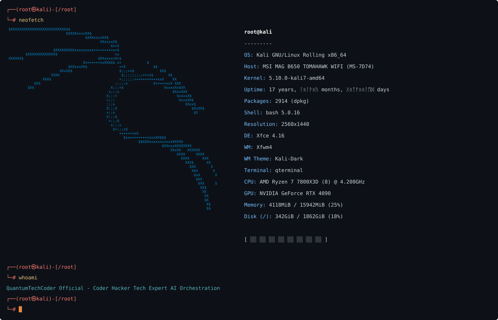

<p align="center">
  
</p>

<p align="center">
  <a href="https://quantumtechcoder.is-a.dev"></a>
  <a href="https://dev.to/quantumtechcoder"></a>
  <a href="https://github.com/QuantumTechCoder"></a>
</p>

<p align="center">
  <a href="https://github.com/QuantumTechCoder">
    
  </a>
</p>

---

## ⚡ Live Telemetry & GitHub Metrics

<p align="center">
  <a href="https://github.com/QuantumTechCoder">
    
  </a>
  <a href="https://github.com/QuantumTechCoder">
    
  </a>
</p>

<p align="center">
  <a href="https://github.com/QuantumTechCoder">
    
  </a>
</p>

---

## 👾 Contribution Velocity

<p align="center">
  <a href="https://quantumtechcoder.is-a.dev">
    <picture>  
      <source media="(prefers-color-scheme: dark)" srcset="https://raw.githubusercontent.com/QuantumTechCoder/QuantumTechCoder/output/snake-dark.svg">
      <source media="(prefers-color-scheme: light)" srcset="https://raw.githubusercontent.com/QuantumTechCoder/QuantumTechCoder/output/snake.svg">
      
    </picture> 
  </a>
</p>

---

## 🚀 Featured Deployments & Systems

<p align="center">
  <a href="https://github.com/QuantumTechCoder/FantasticFractals">
    
  </a>
  <a href="https://github.com/QuantumTechCoder/AirStream">
    
  </a>
</p>
<p align="center">
  <a href="https://github.com/QuantumTechCoder/AstraForxBrowser">
    
  </a>
  <a href="https://github.com/QuantumTechCoder/ByteNews">
    
  </a>
</p>

---

## 🛠️ Weapons of Choice & Technical Arsenal

### 💻 Systems, Security & Runtimes
<p align="left">
  <a href="https://quantumtechcoder.is-a.dev">
    
  </a>
</p>

### ⚡ Languages & Core Stacks
<p align="left">
  <a href="https://quantumtechcoder.is-a.dev">
    
  </a>
</p>

### 🌐 Web, Edge & Distributed Applications
<p align="left">
  <a href="https://quantumtechcoder.is-a.dev">
    
  </a>
</p>

### 🗄️ Persistence & Cloud Infrastructure
<p align="left">
  <a href="https://quantumtechcoder.is-a.dev">
    
  </a>
</p>

---

## 🖥️ System Kernel & Neofetch

<details open>
<summary><b>Click to expand live workstation diagnostic readout</b></summary>
<br>

<p align="center">
  
</p>

</details>

---

## 💎 The Quantum Crypto Vault (Tip Jar)

<p align="center">
  <a href="https://etherscan.io/address/0x2cef0473f985156eDe84312Ce0BeB94B602d26E4">
    
  </a>
</p>

<div align="center">

```text
┌────────────────────────────────────────────────────────────────────────┐
│                   UNIVERSAL MULTI-CHAIN EVM ADDRESS                    │
├────────────────────────────────────────────────────────────────────────┤
│ 0x2cef0473f985156eDe84312Ce0BeB94B602d26E4                             │
└────────────────────────────────────────────────────────────────────────┘
```

**[Etherscan](https://etherscan.io/address/0x2cef0473f985156eDe84312Ce0BeB94B602d26E4)** · **[Basescan](https://basescan.org/address/0x2cef0473f985156eDe84312Ce0BeB94B602d26E4)** · **[Arbiscan](https://arbiscan.io/address/0x2cef0473f985156eDe84312Ce0BeB94B602d26E4)** · **[Polygonscan](https://polygonscan.com/address/0x2cef0473f985156eDe84312Ce0BeB94B602d26E4)**

*All gas-efficient L2s (Base, Arbitrum, Optimism, Polygon, Linea, Scroll, Blast) and native EVM tokens supported!*

</div>

---

<p align="center">
  <sub>⚡ Engineered with pure curiosity by <b>𝕼𝖚𝖆𝖓𝖙𝖚𝖒𝕿𝖊𝖈𝖍𝕮𝖔𝖉𝖊𝖗</b> // <i>"Talk is cheap, Show me the code"</i></sub>
</p>
