<a href="https://quantumtechcoder.is-a.dev"><picture><source media="(prefers-color-scheme: dark)" srcset="https://raw.githubusercontent.com/QuantumTechCoder/QuantumTechCoder/output/snake-dark.svg"><source media="(prefers-color-scheme: light)" srcset="https://raw.githubusercontent.com/QuantumTechCoder/QuantumTechCoder/output/snake.svg"></picture></a>

